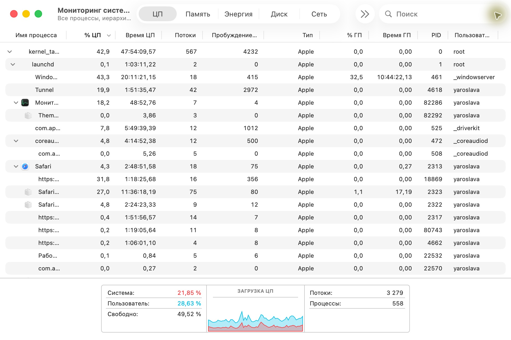
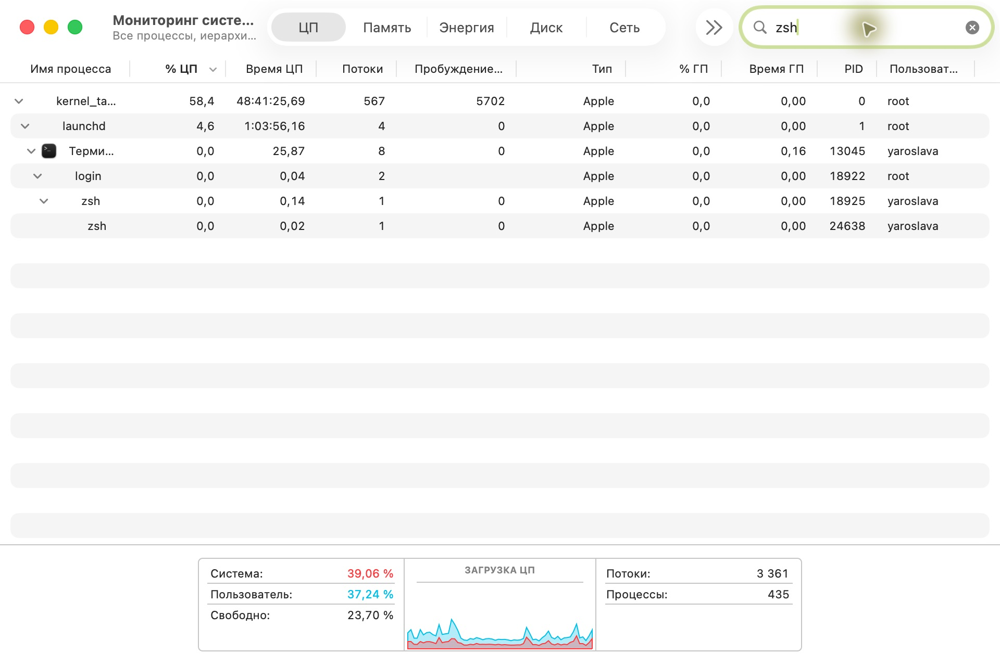
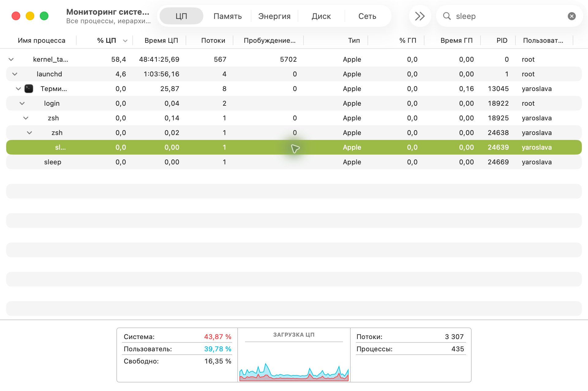
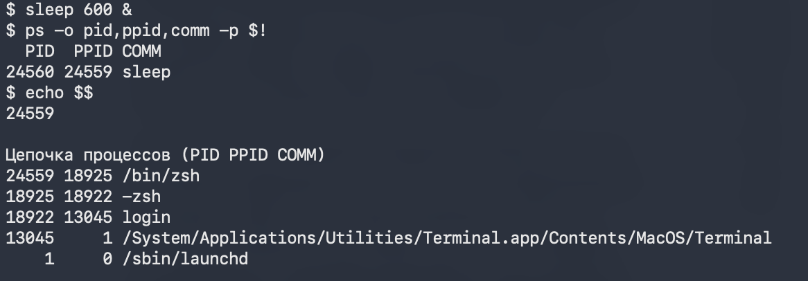
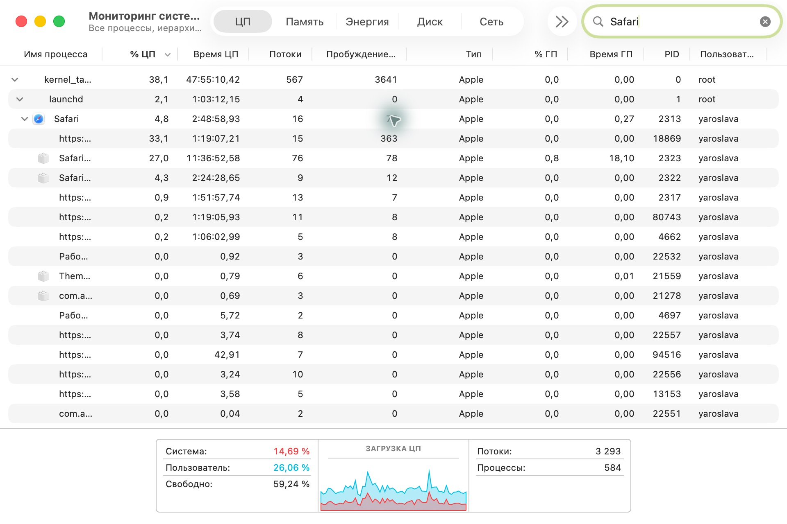
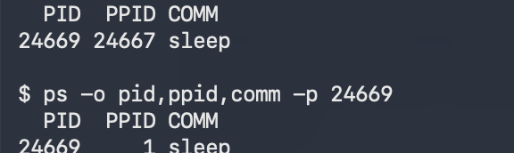
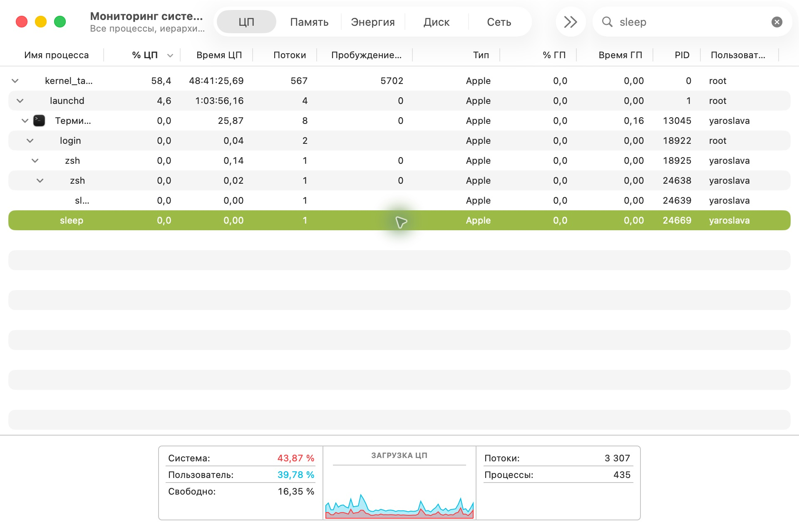

# ЛР 4. Дерево процессов

1. Корень дерева — kernel_task (PID 0). Следом идёт launchd (PID 1).

2. Цепочка процессов — launchd (1) → Терминал (13045) → login (18922) → zsh (18925) → zsh (24638).

3. PID процесса sleep — 24639. PID родителя zsh — 24638.

4. ps -o pid,ppid,comm -p $! показала PPID 24638. echo $$ вывела тот же PID.

5. У Safari видно пять дочерних процессов. Вкладки обслуживают процессы WebKit.

6. У sleep (PID 24669) PPID сменился с 24667 (bash) на 1 (launchd).

7. После завершения bash процесс sleep (24669) виден под launchd.

[Открыть PDF](Лабораторная%20работа%204.pdf)
